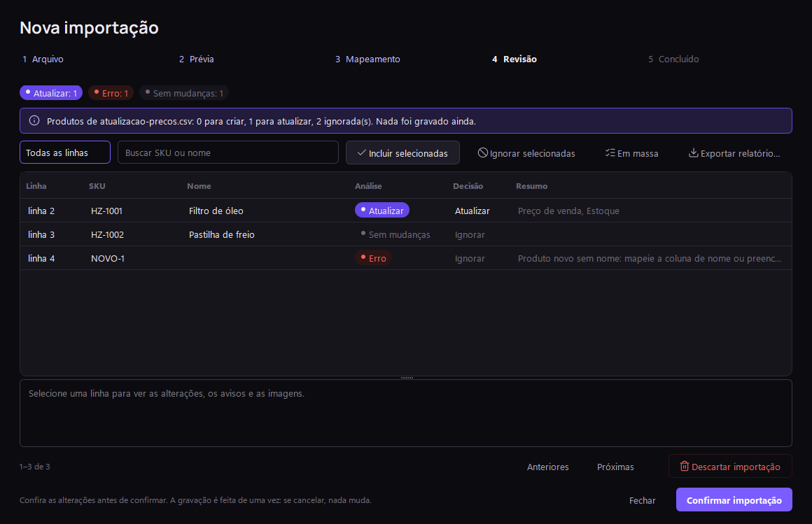
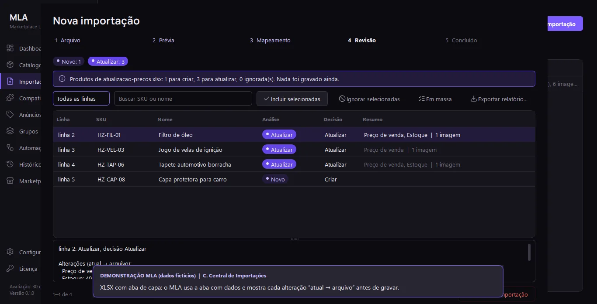
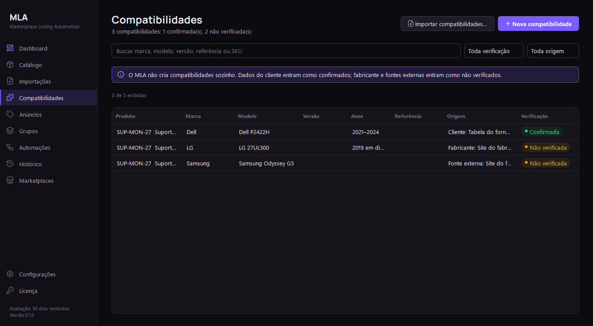
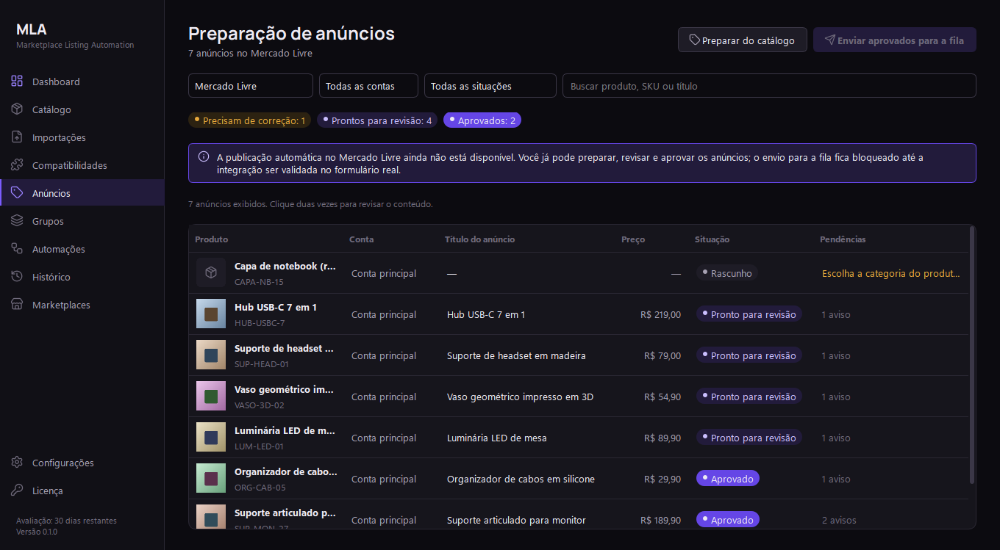
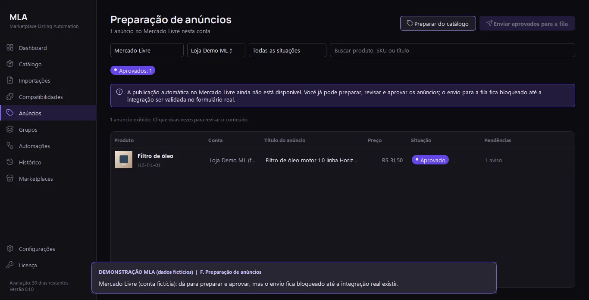
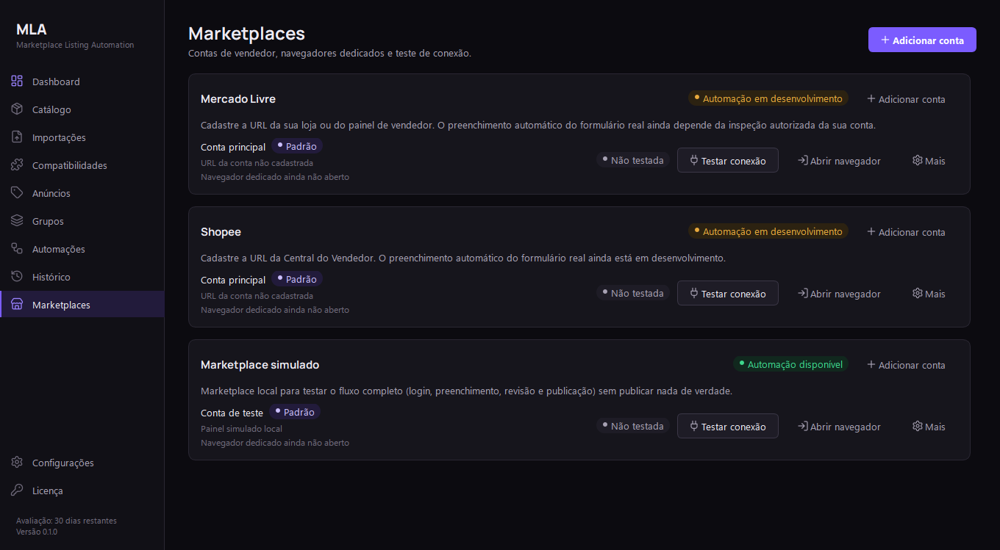
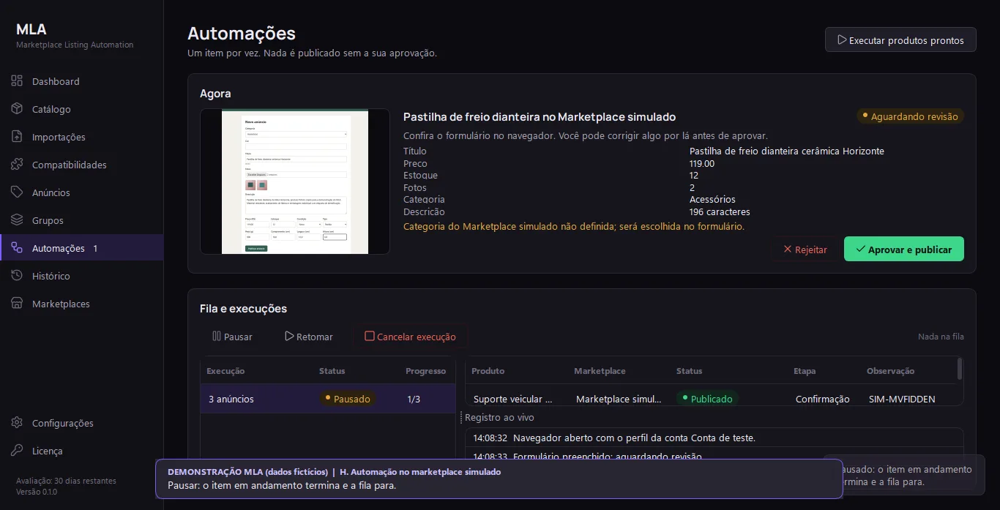
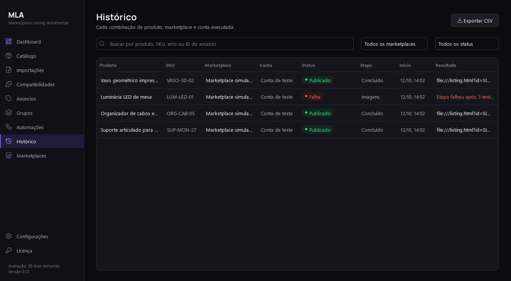
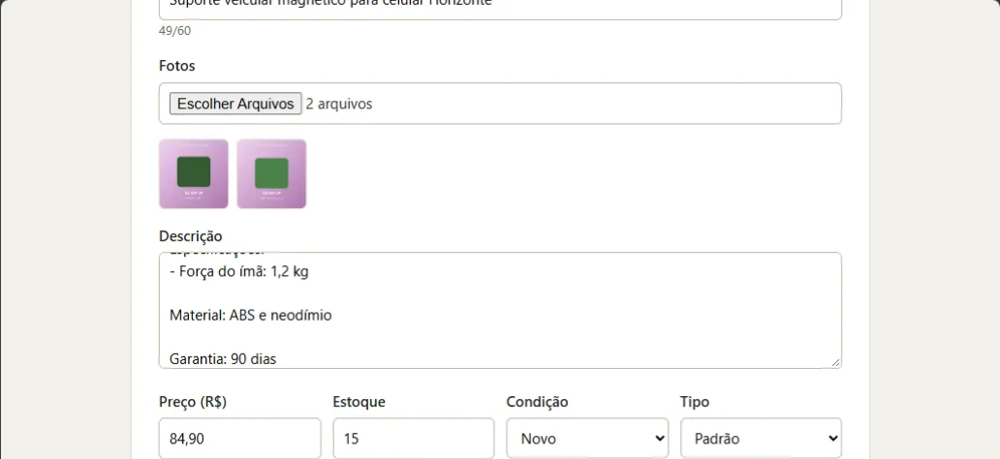

# MLA — Marketplace Listing Automation

**Do catálogo da empresa ao anúncio revisado, em escala.**
Aplicativo desktop para Windows que organiza a base de produtos de um lojista, prepara anúncios por marketplace e
por conta e automatiza o preenchimento no navegador, sempre com revisão humana antes de publicar.

> Este repositório é a **apresentação visual e comercial** do MLA. O código-fonte, os testes e a documentação
> técnica ficam em um repositório privado.
> Página de apresentação: [`index.html`](index.html) (pronta para o GitHub Pages).


| Situação | |
|---|---|
| Versão | 0.1.0 + etapa “Catálogo Mestre Inteligente” |
| Plataforma | Windows 10/11 (desktop) |
| Testes automatizados | 178 (unidade, interface e ponta a ponta no Microsoft Edge) |
| Demonstração visual completa (19/10/2026) | 78 verificações aprovadas, 2 falhas identificadas, 2 itens não executados ([detalhes](#validação-do-sistema--outubro-de-2026)) |
| Publicação real no Mercado Livre e na Shopee | **Em desenvolvimento** — hoje o fluxo completo roda no marketplace simulado incluído |

As capturas abaixo são da interface real do aplicativo, com dados fictícios de demonstração. Os anúncios marcados
como publicados nelas foram publicados no **marketplace simulado**, não em um marketplace real.

---

## O problema
Lojistas que vendem em vários marketplaces costumam ter:
- a base de produtos espalhada em planilhas do ERP, XML, PDFs de fornecedores e pastas de fotos;
- SKUs, preços e estoques divergentes entre canais, sem saber de onde veio cada informação;
- compatibilidades (veículos, aparelhos, equipamentos) anotadas sem fonte e misturadas com suposições;
- trabalho repetitivo e arriscado para adaptar e publicar o mesmo produto em cada marketplace e conta.

## A solução
O MLA mantém um **catálogo mestre** único e confiável, importa bases completas com revisão linha a linha, separa o
produto físico dos seus **anúncios** por marketplace e conta e conduz a publicação por uma **fila com revisão
humana obrigatória**.

---

## Funcionalidades implementadas

### Catálogo mestre inteligente
Identificação completa (SKU principal e de variações, código do fabricante, GTIN/EAN com dígito verificador
conferido, marca, modelo, categoria, fornecedor, nome comercial), dados comerciais (custo, preço de venda e
promocional, estoque e estoque mínimo, unidade, garantia, condição, situação comercial), dados técnicos
(descrição original e técnica, material, cor, peso, dimensões, especificações, atributos personalizados) e mídia
(imagens, variações, arquivos técnicos e mídias pendentes). Checagem ao vivo do que falta para anunciar.

| Catálogo | Editor do produto |
|---|---|
|  |  |

### Gerenciamento de SKUs, preços, estoque e variações
Busca por SKU (inclusive de variação), GTIN, código do fabricante, marca ou fornecedor; SKUs duplicados
bloqueados; variações com SKU, preço e estoque próprios; filtros por situação, mídia pendente e grupo; listas
grandes carregadas aos poucos.

### Central de Importações
CSV, XLSX, JSON, XML, PDF (tabela ou ficha técnica), ZIP com planilha e fotos e pastas de imagens nomeadas pelo SKU.

| Mapeamento das colunas | Revisão antes de gravar |
|---|---|
|  |  |

- Reconhecimento automático de colunas; nomes ambíguos (`codigo`, `saldo`) exigem confirmação; modelos salvos.
- Validação por linha, duplicatas, variações ligadas ao SKU pai, associação de imagens por nome ou SKU.
- Cada alteração aparece como “valor atual → valor do arquivo”; o usuário decide criar, atualizar ou ignorar.
- Nada é gravado antes da confirmação; gravação de uma vez só (cancelar não altera nada); relatório por linha.
- Arquivos executáveis, scripts e planilhas com macro dentro de ZIPs são ignorados e nunca executados.



### Compatibilidade de produtos
Marca, modelo, versão, anos, equipamento e código de referência, com fonte e estado de verificação. Dados do
cliente entram como confirmados; fabricante e fontes externas, como não verificados. Nada é inferido.



### Preparação de anúncios por marketplace e conta
Um produto mestre gera um anúncio por marketplace e conta, guardando só o que muda (título, descrição, preço,
estoque, categoria, atributos, imagens). Estados: Rascunho, Incompleto, Pronto para revisão, Aprovado, Na fila,
Em execução, Publicado confirmado, Falha e Requer intervenção. Nota de completude calculada sem IA.



No Mercado Livre, os anúncios já podem ser preparados e aprovados, mas o envio para a fila fica bloqueado até a
integração real ser validada:



### Marketplaces e contas
Várias contas por marketplace, conta padrão, URL do vendedor validada pelo domínio oficial, **perfil independente do
Edge para cada conta** (nunca o navegador pessoal) e teste de conexão com login manual.



### Automação, filas e grupos
Fila persistente (um item por vez), pausa, retomada, cancelamento, recuperação após fechar o app, prevenção de
duplicados, capturas de tela de cada etapa e **aprovação humana antes de publicar**. Execução individual, em grupo
ou em lote.

| Automações | Grupos |
|---|---|
|  |  |



### Dashboard, histórico, backup e logs
Dashboard com indicadores do catálogo e dos anúncios, pendências e situação por marketplace. Histórico com filtros,
detalhes passo a passo e exportação CSV. Backup manual e automático, restauração e log de cada operação.



### Marketplace simulado
Marketplace local com login, CAPTCHA de teste, formulário e confirmação, para demonstrar o fluxo completo sem
publicar nada de verdade. Abaixo, o formulário do marketplace simulado preenchido pelo MLA (título, fotos,
descrição, preço e estoque vindos do catálogo):



---

## Validação do Sistema — Outubro de 2026
Em 19/10/2026 o MLA passou por uma demonstração visual completa, roteirizada e gravada, módulo por módulo. Foram
usados o **aplicativo desktop real**, **dados fictícios** numa pasta isolada (sem contato com dados reais) e o
**marketplace simulado** incluído no app. Cada resultado foi conferido no banco de dados, e não apenas na tela.

| Resultado | Quantidade |
|---|---|
| Verificações aprovadas | **78** |
| Falhas identificadas | **2** |
| Itens não executados | **2** |

**Validado na demonstração:** dashboard e navegação; cadastro completo no catálogo mestre (GTIN, variações,
imagens, especificações); importações CSV, XLSX, JSON, XML, PDF, ZIP e fotos por SKU, com cancelamento sem gravar
nada; compatibilidades; grupos; contas com perfis independentes do Edge; preparação, validação e aprovação de
anúncios; automação com fila, pausa, retomada, CAPTCHA simulado, rejeição, cancelamento, prevenção de duplicatas e
recuperação após fechar o app; histórico, backup, restauração e logs.

**Falhas identificadas (em correção):**
- o botão “Reexecutar” do Histórico recusa anúncios preparados pela tela de Anúncios; há um contorno pela própria
  tela de Anúncios;
- o campo de preço do editor aceita letras e as descarta sem avisar.

**Não executados:** o teste de conexão com contas reais de Mercado Livre e Shopee (por regra, nenhuma conta real foi
acessada) e a simulação de uma falha definitiva de etapa, que o marketplace simulado não oferece pela interface.

> A demonstração **não comprova publicação real** no Mercado Livre ou na Shopee: todas as publicações exibidas
> foram feitas no marketplace simulado.

---

## Arquitetura
```
Interface (PySide6)  ──▶  Serviços (regras de negócio)  ──▶  Persistência (SQLite, migrações versionadas)
        │                         ▲
        │                         │
        └──▶ Importação (CSV/XLSX/JSON/XML/PDF/ZIP → plano → revisão → gravação em transação)
        └──▶ Automação (thread de execução, Playwright) ──▶ Adaptadores por marketplace ──▶ Microsoft Edge
```
- Dados locais em `%LOCALAPPDATA%\MLA`, backup automático antes de cada atualização do banco.
- Produto mestre separado do anúncio; cada anúncio guarda só as diferenças em relação ao produto.
- Dados do cliente, informações externas e sugestões de IA ficam em estruturas separadas.

## Tecnologias
Python 3.13 · PySide6 (Qt) · SQLite (WAL) · Playwright + Microsoft Edge · openpyxl · pypdf · pytest

## Princípios
- Nada é publicado sem aprovação; “publicado” só com confirmação do marketplace.
- Login, CAPTCHA e verificações são sempre feitos pelo usuário; nenhum bloqueio é contornado.
- Importações nunca apagam registros nem substituem dados sem mostrar a alteração.
- Hipóteses nunca são apresentadas como fatos.

---

## Em desenvolvimento
As integrações reais com marketplaces **ainda precisam de validação**:
- **Publicação real no Mercado Livre** — depende da inspeção autorizada do formulário real da conta do vendedor.
- **Publicação real na Shopee** — depois do Mercado Livre.
- Estrutura já preparada (sem telas e sem coleta ativa): URLs de referência de concorrentes com fonte e data,
  contrato para coletores (API oficial primeiro; Scrapling só quando permitido) e armazenamento de sugestões de IA
  aplicadas apenas com aceite do usuário.

## Roadmap
| Etapa | Situação |
|---|---|
| Base do app, catálogo, grupos, fila com revisão, marketplace simulado | Concluído |
| Catálogo mestre, Central de Importações, compatibilidades, preparação de anúncios, contas | Concluído |
| Demonstração visual completa e relatório de validação (19/10/2026) | Concluído |
| Segurança do navegador Edge: sandbox ativado nos perfis da automação | Próxima etapa |
| Correção do botão “Reexecutar” no Histórico | Próxima etapa |
| Validação rigorosa de preços no editor | Próxima etapa |
| Ajustes de responsividade do Dashboard | Próxima etapa |
| Melhorias na etapa de conclusão das importações | Próxima etapa |
| Testes de conexão real com marketplaces, mediante autorização do lojista | Planejado |
| Inspeção autorizada e integração real com o Mercado Livre; depois, Shopee | Planejado |
| Telas de regras por categoria, consentimento de IA e imagens por variação | Planejado |
| Instalador, licenças assinadas e teste em máquina limpa | Planejado |
| Inteligência de mercado com Scrapling (só onde permitido) e agentes de otimização com IA | Planejado |

---

O código-fonte, os testes e a documentação técnica do MLA são mantidos em um repositório privado.
