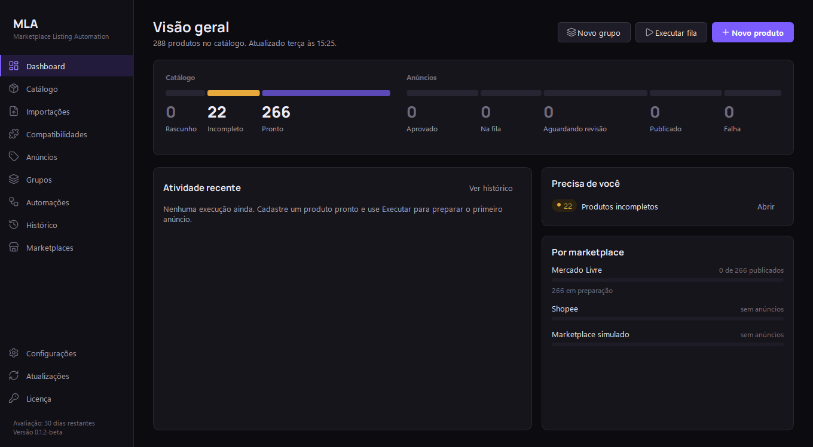
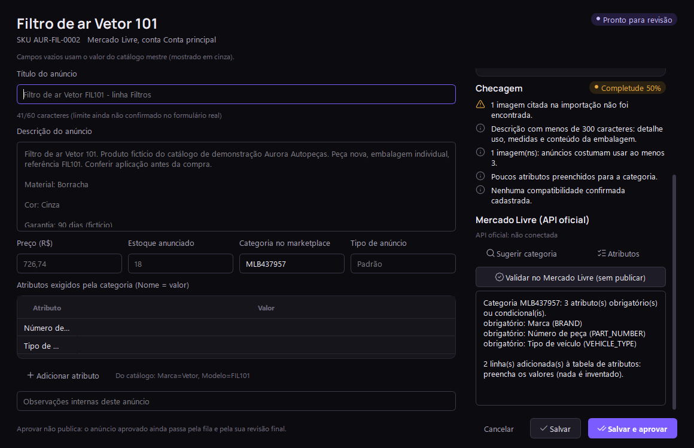
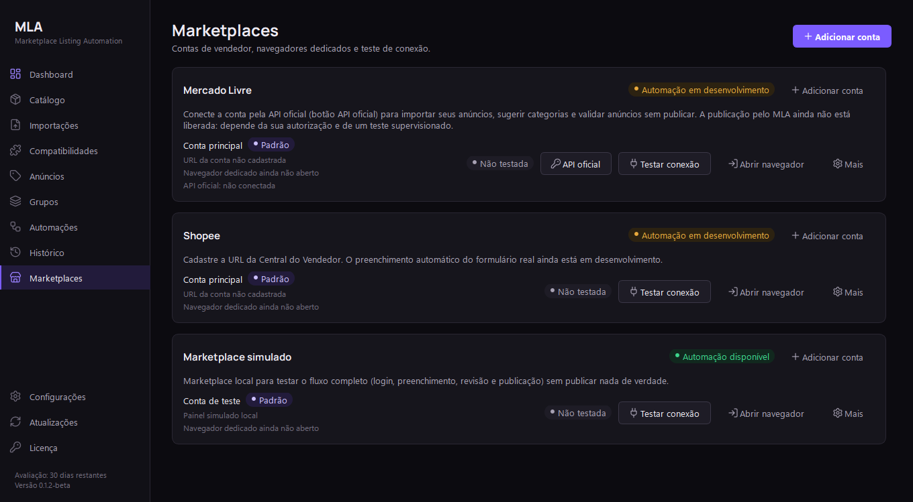
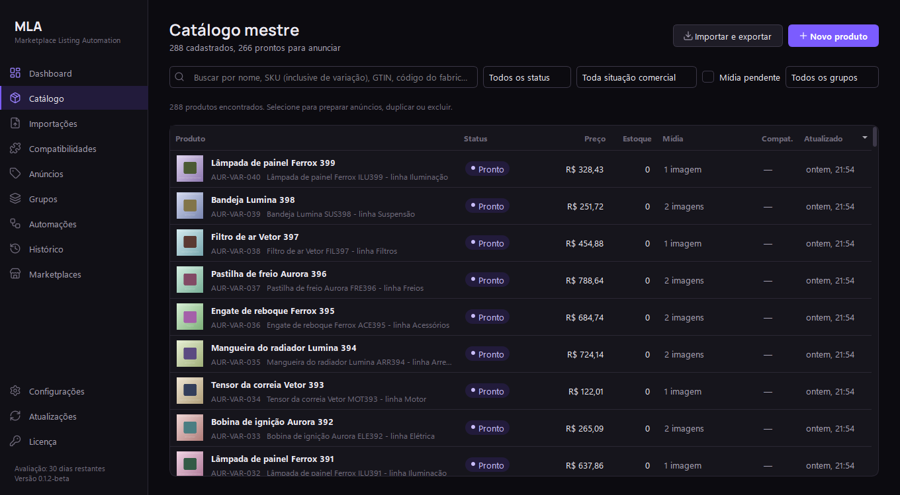
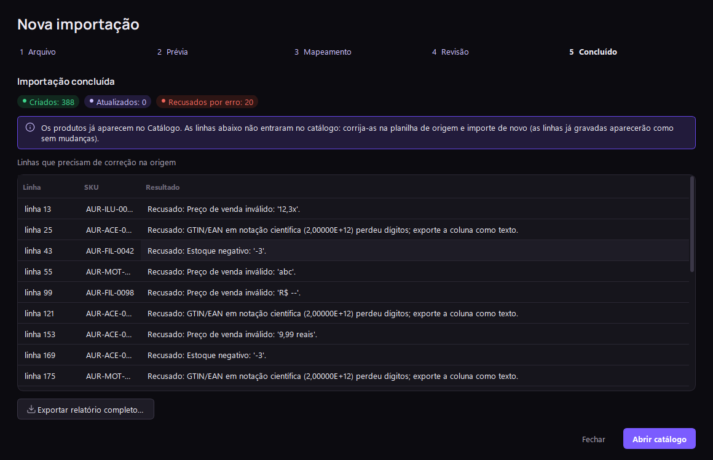

# MLA — Marketplace Listing Automation

**Do catálogo da empresa ao anúncio revisado, em escala.**
Aplicativo para Windows (instalável, versão beta) que organiza a base de produtos de um lojista, prepara anúncios
por marketplace e por conta e se conecta ao Mercado Livre pela API oficial para validar anúncios antes de publicar,
sempre com revisão humana.

> Este repositório é a **apresentação visual e comercial** do MLA. O código-fonte, os testes e a documentação
> técnica ficam em um repositório privado.
> Página de apresentação: [`index.html`](index.html) (pronta para o GitHub Pages).



| Situação | |
|---|---|
| Versão | **0.1.2-beta** — aplicativo Windows instalável |
| Plataforma | Windows 10/11 (64 bits), com Microsoft Edge |
| Download | [Releases deste repositório](https://github.com/kelvinsg218/marketplace-listing-automation-showcase/releases) (só o instalador e o SHA-256; o código-fonte é privado) |
| Testes automatizados | 256 aprovados, 0 falhos (unidade, interface e ponta a ponta no Microsoft Edge) |
| Mercado Livre | API oficial: conexão, importação, categoria, atributos e **validação sem publicar** ([detalhes](#mercado-livre-pela-api-oficial)) |
| Publicação real no Mercado Livre | **Não validada** — desligada nesta versão |
| Shopee | Sem integração |

As capturas são da interface real do aplicativo, com dados fictícios de demonstração. Os anúncios marcados como
publicados em capturas antigas foram publicados no **marketplace simulado**, não em um marketplace real.

---

## Instalar a versão beta
1. Em [Releases](https://github.com/kelvinsg218/marketplace-listing-automation-showcase/releases), baixe `MLA-Setup-<versão>.exe` e `MLA-Setup-<versão>.exe.sha256`.
2. Confira o arquivo no PowerShell: `Get-FileHash .\MLA-Setup-<versão>.exe -Algorithm SHA256` deve mostrar o mesmo
   código do `.sha256`. Se for diferente, não instale.
3. Dê dois cliques no instalador (não precisa ser administrador). Como ainda não há assinatura digital, o Windows
   pode mostrar "O Windows protegeu o computador": confira o código e use **Mais informações → Executar assim mesmo**.
4. O MLA abre no fim. Programa em `%LOCALAPPDATA%\Programs\MLA`; dados em `%LOCALAPPDATA%\MLA`.

**Atualizações:** no MLA, **Atualizações → Verificar agora → Baixar e instalar**. O app consulta as releases deste
repositório, confere o SHA-256 do instalador, fecha, instala e abre de novo. Catálogo, contas, configurações, fila e
histórico são mantidos, e o banco recebe backup antes de qualquer migração.

**Desinstalar:** Configurações do Windows → Aplicativos instalados → MLA → Desinstalar (os dados ficam).


## Mercado Livre pela API oficial
A conta é conectada pelo fluxo oficial de autorização do Mercado Livre (o usuário cria o próprio aplicativo
gratuito no portal de desenvolvedores). O MLA nunca pede nem guarda a senha; os códigos de acesso ficam
criptografados no Windows do usuário.
- **Sugerir categoria** pelo preditor oficial e **ver os atributos obrigatórios** da categoria (o MLA cria as linhas,
  você preenche; nada é inventado).
- **Validar no Mercado Livre (sem publicar):** o validador oficial confere o anúncio e nenhum anúncio é criado.
- **Importar os anúncios da conta** para o catálogo, com revisão antes de gravar.
- **Publicação: desligada** nesta versão; será liberada só com autorização do lojista, em teste supervisionado.



A categoria sugerida e os atributos desta captura vieram do Mercado Livre de verdade (endpoints públicos).
Conexão, importação e validação foram testadas contra uma simulação dos endpoints documentados, **ainda não com
uma conta real**.



## Status dos testes — 0.1.2-beta
| Item | Situação |
|---|---|
| Instalação pelo assistente e silenciosa; abertura sem terminal | Testado |
| Recusa de instalar com o MLA aberto; desinstalação mantendo os dados | Testado |
| Atualização entre versões pela interface (dados idênticos, backup antes da migração) | Testado |
| Canal de atualizações no GitHub e download com conferência SHA-256 pela internet | Testado |
| Importação de 300 produtos fictícios, 519 fotos, PDF e erros intencionais (integridade 100%) | Testado |
| Mercado Livre: sugestão de categoria e atributos (endpoints públicos reais) | Testado |
| Mercado Livre: conexão, importação e validação sem publicar | Testado só com simulação |
| Computador limpo / segundo computador | Pendente |
| Conta real do Mercado Livre | Pendente |
| Publicação real no Mercado Livre | Não validada (desligada) |

## Limitações conhecidas
- Publicação no Mercado Livre desligada; Shopee sem integração.
- A validação do Mercado Livre ainda não envia fotos nem variações.
- Instalador sem assinatura digital (aviso do SmartScreen); não testado em computador limpo.
- O desinstalador abre uma janela de console por alguns segundos.





---

## O problema
Lojistas que vendem em vários marketplaces costumam ter:
- a base de produtos espalhada em planilhas do ERP, XML, PDFs de fornecedores e pastas de fotos;
- SKUs, preços e estoques divergentes entre canais, sem saber de onde veio cada informação;
- compatibilidades (veículos, aparelhos, equipamentos) anotadas sem fonte e misturadas com suposições;
- trabalho repetitivo e arriscado para adaptar e publicar o mesmo produto em cada marketplace e conta.

## A solução
O MLA mantém um **catálogo mestre** único e confiável, importa bases completas com revisão linha a linha, separa o
produto físico dos seus **anúncios** por marketplace e conta e conduz a publicação por uma **fila com revisão
humana obrigatória**.

---

## Funcionalidades implementadas

### Catálogo mestre inteligente
Identificação completa (SKU principal e de variações, código do fabricante, GTIN/EAN com dígito verificador
conferido, marca, modelo, categoria, fornecedor, nome comercial), dados comerciais (custo, preço de venda e
promocional, estoque e estoque mínimo, unidade, garantia, condição, situação comercial), dados técnicos
(descrição original e técnica, material, cor, peso, dimensões, especificações, atributos personalizados) e mídia
(imagens, variações, arquivos técnicos e mídias pendentes). Checagem ao vivo do que falta para anunciar.

| Catálogo | Editor do produto |
|---|---|
|  |  |

### Gerenciamento de SKUs, preços, estoque e variações
Busca por SKU (inclusive de variação), GTIN, código do fabricante, marca ou fornecedor; SKUs duplicados
bloqueados; variações com SKU, preço e estoque próprios; filtros por situação, mídia pendente e grupo; listas
grandes carregadas aos poucos.

### Central de Importações
CSV, XLSX, JSON, XML, PDF (tabela ou ficha técnica), ZIP com planilha e fotos e pastas de imagens nomeadas pelo SKU.

| Mapeamento das colunas | Revisão antes de gravar |
|---|---|
|  |  |

- Reconhecimento automático de colunas; nomes ambíguos (`codigo`, `saldo`) exigem confirmação; modelos salvos.
- Validação por linha, duplicatas, variações ligadas ao SKU pai, associação de imagens por nome ou SKU.
- Cada alteração aparece como “valor atual → valor do arquivo”; o usuário decide criar, atualizar ou ignorar.
- Nada é gravado antes da confirmação; gravação de uma vez só (cancelar não altera nada); relatório por linha.
- Arquivos executáveis, scripts e planilhas com macro dentro de ZIPs são ignorados e nunca executados.


### Compatibilidade de produtos
Marca, modelo, versão, anos, equipamento e código de referência, com fonte e estado de verificação. Dados do
cliente entram como confirmados; fabricante e fontes externas, como não verificados. Nada é inferido.


### Preparação de anúncios por marketplace e conta
Um produto mestre gera um anúncio por marketplace e conta, guardando só o que muda (título, descrição, preço,
estoque, categoria, atributos, imagens). Estados: Rascunho, Incompleto, Pronto para revisão, Aprovado, Na fila,
Em execução, Publicado confirmado, Falha e Requer intervenção. Nota de completude calculada sem IA.


No Mercado Livre, os anúncios já podem ser preparados e aprovados, mas o envio para a fila fica bloqueado até a
integração real ser validada:


### Marketplaces e contas
Várias contas por marketplace, conta padrão, URL do vendedor validada pelo domínio oficial, **perfil independente do
Edge para cada conta** (nunca o navegador pessoal) e teste de conexão com login manual.


### Automação, filas e grupos
Fila persistente (um item por vez), pausa, retomada, cancelamento, recuperação após fechar o app, prevenção de
duplicados, capturas de tela de cada etapa e **aprovação humana antes de publicar**. Execução individual, em grupo
ou em lote.

| Automações | Grupos |
|---|---|
|  |  |


### Dashboard, histórico, backup e logs
Dashboard com indicadores do catálogo e dos anúncios, pendências e situação por marketplace. Histórico com filtros,
detalhes passo a passo e exportação CSV. Backup manual e automático, restauração e log de cada operação.


### Marketplace simulado
Marketplace local com login, CAPTCHA de teste, formulário e confirmação, para demonstrar o fluxo completo sem
publicar nada de verdade. Abaixo, o formulário do marketplace simulado preenchido pelo MLA (título, fotos,
descrição, preço e estoque vindos do catálogo):


---

## Demonstração visual — 19/10/2026
Em 19/10/2026 o MLA passou por uma demonstração visual completa, roteirizada e gravada, módulo por módulo. Foram
usados o **aplicativo desktop real**, **dados fictícios** numa pasta isolada (sem contato com dados reais) e o
**marketplace simulado** incluído no app. Cada resultado foi conferido no banco de dados, e não apenas na tela.

| Resultado | Quantidade |
|---|---|
| Verificações aprovadas | **78** |
| Falhas identificadas | **2** |
| Itens não executados | **2** |

**Validado na demonstração:** dashboard e navegação; cadastro completo no catálogo mestre (GTIN, variações,
imagens, especificações); importações CSV, XLSX, JSON, XML, PDF, ZIP e fotos por SKU, com cancelamento sem gravar
nada; compatibilidades; grupos; contas com perfis independentes do Edge; preparação, validação e aprovação de
anúncios; automação com fila, pausa, retomada, CAPTCHA simulado, rejeição, cancelamento, prevenção de duplicatas e
recuperação após fechar o app; histórico, backup, restauração e logs.

**Falhas identificadas (corrigidas na 0.1.x, com testes automáticos):**
- o botão “Reexecutar” do Histórico recusava anúncios preparados pela tela de Anúncios;
- o campo de preço do editor aceitava letras e as descartava sem avisar.

**Não executados:** o teste de conexão com contas reais de Mercado Livre e Shopee (por regra, nenhuma conta real foi
acessada) e a simulação de uma falha definitiva de etapa, que o marketplace simulado não oferece pela interface.

> A demonstração **não comprova publicação real** no Mercado Livre ou na Shopee: todas as publicações exibidas
> foram feitas no marketplace simulado.

---

## Arquitetura
```
Interface (PySide6)  ──▶  Serviços (regras de negócio)  ──▶  Persistência (SQLite, migrações versionadas)
        │                         ▲
        │                         │
        └──▶ Importação (CSV/XLSX/JSON/XML/PDF/ZIP → plano → revisão → gravação em transação)
        └──▶ Automação (thread de execução, Playwright) ──▶ Adaptadores por marketplace ──▶ Microsoft Edge
```
- Dados locais em `%LOCALAPPDATA%\MLA`, backup automático antes de cada atualização do banco.
- Produto mestre separado do anúncio; cada anúncio guarda só as diferenças em relação ao produto.
- Dados do cliente, informações externas e sugestões de IA ficam em estruturas separadas.

## Tecnologias
Python 3.13 · PySide6 (Qt) · SQLite (WAL) · Playwright + Microsoft Edge · openpyxl · pypdf · pytest

## Princípios
- Nada é publicado sem aprovação; “publicado” só com confirmação do marketplace.
- Login, CAPTCHA e verificações são sempre feitos pelo usuário; nenhum bloqueio é contornado.
- Importações nunca apagam registros nem substituem dados sem mostrar a alteração.
- Hipóteses nunca são apresentadas como fatos.

---

## Em desenvolvimento
- **Publicação real no Mercado Livre** — pela API oficial, só com autorização do lojista e em teste supervisionado.
- **Publicação real na Shopee** — depois do Mercado Livre.
- Estrutura já preparada (sem telas e sem coleta ativa): URLs de referência de concorrentes com fonte e data,
  contrato para coletores (API oficial primeiro; Scrapling só quando permitido) e armazenamento de sugestões de IA
  aplicadas apenas com aceite do usuário.

## Roadmap
| Etapa | Situação |
|---|---|
| Base do app, catálogo, grupos, fila com revisão, marketplace simulado | Concluído |
| Catálogo mestre, Central de Importações, compatibilidades, preparação de anúncios, contas | Concluído |
| Demonstração visual completa e relatório de validação (19/10/2026) | Concluído |
| Correções da demonstração (sandbox do Edge, Reexecutar, preços, Dashboard, tela de importação) | Concluído |
| Empresas separadas, histórico por campo, edição em lote, exportação de planilha, relatório de pendências | Concluído |
| Aplicativo Windows instalável com atualizações (0.1.2-beta) | Concluído |
| Mercado Livre pela API oficial: conexão, importação, categoria, atributos, validação sem publicar | Concluído (sem conta real) |
| Teste em um segundo computador e com uma conta real do Mercado Livre | Próxima etapa |
| Publicação real supervisionada no Mercado Livre, só com autorização; depois, Shopee | Planejado |
| Fotos e variações na validação; imagens por variação; regras por categoria | Planejado |
| Assinatura digital do instalador e licenças assinadas | Planejado |
| Inteligência de mercado com Scrapling (só onde permitido) e agentes de otimização com IA | Planejado |

---

O código-fonte, os testes e a documentação técnica do MLA são mantidos em um repositório privado.
